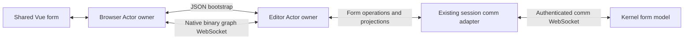

# ADR 0054: Notebook form Actor attachments

Status: Accepted

## Context

ADR 0053 supplies browser-capable connections but leaves product admission and reference routing
to the frontend. Notebook forms already have an editor-owned comm adapter, pinned-session
admission, shared Vue rendering and readonly snapshots. Their browser/extension messages bypass
the Actor lifecycle, correlation and bounded channel machinery.

## Decision

Use the product-owned browser Actor runtime for the notebook form renderer's connection to its
extension host. Keep the shared Vue form implementation and authenticated session comm adapter.
A standalone host can use the same browser and host bundles without VS Code APIs.

`createActorFormRenderer` is an additive browser ESM API. It starts no I/O until the shared form
renderer emits a live mount. `snapshot:true` emits no Actor request, never acquires state and
remains readonly. The existing `createFormRenderer` API remains usable by explicit standalone
message adapters. The notebook adapter uses the Actor API; old raw mount/event envelopes are no
longer admitted by the extension's form renderer channel.

The browser asks for an attachment using a version-two `maieutics-form-actor` bootstrap envelope. The host
offers an opaque connection ID and increasing editor-local epoch only when that editor is
visible and has an explicit pinned session. Neither model/view IDs nor renderer fields select
a session. The offer selects the production binary graph codec and a one-use authorized
WebSocket endpoint (ADR 0055). Both peers use Actor protocol 2 with stock payload codecs and
correlated request/reply channels. Renderer messaging carries bootstrap controls only; Actor
frames use native binary. The existing form/comm business schema is unchanged.

The host advertises only `forms.mount`, `forms.unmount` and `forms.event`; the browser advertises
only `view.receive`. The host checks its editor, pinned session, visibility and generation again
at dispatch. Events require the exact mounted model/view pair and a submit/cancel action. The
host converts operations into the existing comm adapter contract, so raw Actor frames never
cross into the comm endpoint. No generic Actor acquire route or REPL execution surface is
exposed to the browser. Plugin HTTP remains governed by ADR 0051.

Hiding or closing one editor retires its Actor connection and cancels its comm scope. Dormant
identities remain weak. When the same editor becomes visible under the same pin, the host offers
a fresh connection; the browser restores only current mounts. User actions are never replayed.
A session change invalidates dormant mounts, including a change while hidden. Frames from an
older epoch/connection cannot dispatch or update the new scope. Retired form views lose state
admission, so a fresh view with an overlapping model ID cannot reactivate them. The last unmount
closes the browser attachment without closing the shared kernel model.

Retirement revokes a generation synchronously, starts comm cancellation before joining Actor
dispatch, observes outstanding calls/posts, and joins connection/codec cleanup. New admission
does not wait for retired teardown. Asynchronous extension deactivation joins form owners,
controller and connection. A post rejection or false delivery result terminates the attachment
and is reported through cleanup and diagnostics.

Admission is bounded: 128 active/retiring editor offers, 128 views per connection, eight logical
channels, 128 pending RPCs, and ten seconds for an unanswered offer. Each native message is
bounded to one MiB of binary graph encoding and reconstructed buffer storage, 16,384 graph
nodes, 65,536 items/array slots and depth 64. Transport decoding admits 512 queued frames and four
MiB combined bytes. Bootstrap/native-message post owners also have bounded count/byte budgets. Overflow fails the
attachment explicitly; models and unrelated editors retain their owners.

The output-client build produces a browser ESM and separate self-contained host ESM with
declarations. `build:vscode` copies these into the extension's `media/` and `runtime/`. Extension
host sources import only that local artifact, preserving standalone packaging. CI rebuilds and
checks both committed artifacts. Neither artifact includes process creation or Node adapters;
the extension-only WebSocket gateway uses pinned ws 8.23.0. Original Actor runtime LICENSE/NOTICE
and the ws MIT license accompany the distributions.

## Compatibility and verification

This changes only the lockstep notebook renderer/extension attachment protocol. Frontend REST,
comm framing, form MIME, SDK producers, rendering capabilities and notebook snapshots retain
their contracts. Kernel rendering and SSR assets are unchanged.

The extension minimum becomes VS Code 1.101, whose Node 22 host supports the runtime's existing
`Promise.withResolvers` use. The former 1.99 minimum would admit a Node 20 host that fails during
connection construction; see the [official runtime update](https://code.visualstudio.com/updates/v1_101#_electron-35-update).

Focused tests cover correlated calls, editor isolation, stale frames, hidden/repinned views,
last-unmount release, startup cancellation, nonblocking replacement, delivery/cleanup failures,
native-value budgets and the full 128-view burst. Actual VS Code coverage crosses browser/host
messaging, verifies snapshot denial and draft preservation, and proves a new session cannot
revive old views. Existing two-session/two-group notebook tests retain their real comm-socket
assertions and release only the closed editor's exact connection.
