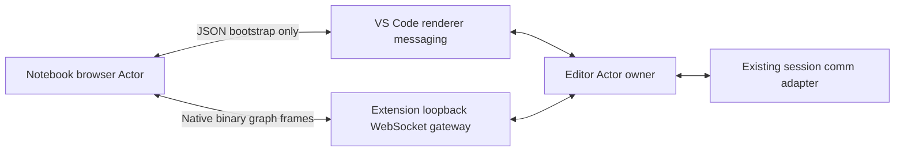

# ADR 0055: Binary Actor graphs and notebook data channels

Status: Accepted

## Context

The notebook renderer messaging API crosses VS Code's JSON IPC. An Actor payload codec alone cannot
make that bridge retain cyclic graphs or native binary. ADR 0054 therefore needs a separate data
channel as well as a portable wire encoding. V8 serialization is host-specific; the browser entry
must stay independent of Node and Deno adapters.

## Decision

Export `createBinaryGraphCodec` from the browser and host Actor entries. Its identifier is
`maieutics-binary-graph/1`. Each frame has independent object IDs, bounded binary storage and no
shared record dictionary. It implements `WireCodec`; selecting it is explicit and does not change
the existing host V8 adapters or plain JSON conformance path. No serialization package or runtime
download is required.

### Value and binary semantics

Ordinary/null-prototype objects, arrays including holes, Map, Set and their cycles/shared references
round-trip. Payload traversal preserves holes, enumerable array properties and null prototypes; own
`__proto__` keys remain data. Values include undefined, null, booleans, numbers including -0/NaN/
infinities, strings including lone surrogates, and bounded BigInts. ArrayBuffer, the eleven
supported typed-array constructors, DataView, Date, RegExp, native Error subclasses, AggregateError
and DOMException have explicit tags. Error causes and AggregateError members participate in the same
graph. RegExp lastIndex resets, matching ordinary structured clone.

Binary data is copied as raw byte spans. Views retain their type, byte offset, byte length and
shared backing identity. An explicitly passed ArrayBuffer authorizes its whole contents. An implicit
backing buffer exposes only the union of the transmitted views' spans; unexposed bytes reconstruct
as zeros. This preserves overlapping views without leaking adjacent bytes from Node's pooled
buffers. Reconstructed backing storage, including zeroed gaps, counts against admission. Large data
uses the existing credit-driven iterable codec with independently owned bounded chunks.

Functions, symbols, accessors on ordinary data objects, weak collections, arbitrary prototypes, Blob
values and SharedArrayBuffer are not implicitly reconstructed. Stateful/custom values use Actor
payload codecs first. Shared memory requires an explicit snapshot before network transfer. The wire
decoder accepts a native Blob frame after checking its size, and observes cancellation before and
after its arrayBuffer conversion. This is distinct from encoding a Blob RPC value.

### Wire format, version one

All integers and float64 values use little endian. Strings store a uint32 code-unit length and
UTF-16LE code units, preserving all JavaScript strings. Binary never passes through those string
fields. A native WebSocket message carries exactly one frame:

```text
uint32 magic = 0x4742414d (bytes M A B G)
uint8 version = 1
uint32 objectCount
root value token
object definitions in ID order
```

Value tags 0–7 are undefined, null, false, true, float64, string, BigInt, and an object-table
reference. BigInt stores a sign, uint32 byte count and little-endian magnitude, at most 1,024 bytes.
Object tags 0–10 are object, null-prototype object, array, Map, Set, ArrayBuffer, typed view, Date,
RegExp, native Error and DOMException.

Object/array definitions contain bounded string-key/value entries; arrays also record length.
Map/Set definitions contain value tokens. A buffer records its allocation length and ordered,
non-overlapping offset/length/raw-byte spans. A view references a buffer ID and records its type,
offset and byte length. Dates contain float64 timestamps. RegExp contains source and flags. Errors
contain a whitelisted native constructor ID and property entries, including enumerability;
DOMException records message/name plus enumerable data. Native lazy stack formatting is captured as
data. No constructor names from the peer are evaluated or looked up on globalThis.

Decoding allocates a bounded object table, creates views after buffers exist, then fills data
properties and collection entries. Property definition cannot trigger **proto** setters. The decoder
rejects unknown tags/versions, truncation, trailing bytes, invalid references, duplicate object
properties, invalid binary spans, invalid view alignment and unreachable definitions. Decoded graphs
undergo a bounded first-visit depth check. Failures are typed Actor transport errors and fail the
owning connection rather than leaving pending calls unsettled.

Defaults are one MiB encoded bytes and total reconstructed buffer storage, 16,384 objects, 65,536
items/array slots, and depth 64. Limits are configurable per codec instance. Objects are never
retained across frames. There is no compression or textual binary fallback.

### Notebook admission and ownership



The outer form attachment protocol becomes version 2. Renderer messaging carries only request,
offer, release, closed and unavailable controls. An offer contains the encoding ID and an opaque
one-use endpoint. Every Actor/Mux frame, including hello and codec-channel traffic, crosses the
WebSocket as native binary. JSON bootstrap never carries binary payloads or graph descriptors.
Standalone hosts can instead supply a native-binary-preserving message transport; the notebook host
always configures the separate endpoint.

The extension lazily binds one HTTP/WebSocket listener to 127.0.0.1 on an ephemeral port. Each
offered editor generation receives an independent 256-bit token; admission compares it in constant
time and consumes it before upgrading. Unknown, wrong, reused and revoked credentials are denied.
The server exposes no other API, disables compression, limits frames to one MiB and reserves at most
128 leases/256 sockets. Incomplete HTTP handshakes have a five-second budget. Host
session/visibility checks still run when the socket is accepted and when methods dispatch.

`vscode.env.asExternalUri` resolves the listening base for remote extension hosts; routing
prefixes/query parameters survive. Credentials are appended afterward and are never passed to the
port-forwarding resolver or logged. Hidden/closed/repinned editors abort their lease and terminate
their binary peer. New generations do not wait for old comm teardown. Gateway disposal joins
startup, revokes leases, destroys remaining sockets and joins both listeners. Failed endpoint
publication closes the partially started listener before returning the startup error.
The permanent server-error observer is installed before binding; the listening callback switches
to runtime failure handling before removing the startup observer, leaving no microtask gap.

Browser startup has owned open/error/close/abort listeners and a timeout; retirement rejects mount
waits before joining dispatch. A blocked or failed socket leaves forms readonly with diagnostics.
Hosts must permit the selected ws/wss connection in their CSP; this change neither weakens a host
CSP nor falls back to JSON data. Remote forwarding is delegated to VS Code.

Only the narrow form/view Actor surfaces are exposed. The kernel comm/form schema, binary buffer
framing, MIME and notebook persistence contracts do not change. Generic binary graphs on this Actor
hop do not broaden the existing form business schema or expose REPL execution.

The host-only gateway uses pinned ws 8.23.0 (MIT) with its license shipped in the VSIX. The shared
runtime/browser bundle has no new dependency. The codec source ships through the existing SDK and
executable resource globs, with publish-plan and materialized-import checks.

## Verification

Codec tests cover cyclic/shared graphs, sparse arrays, native errors, all supported binary views,
shared backing stores, slab privacy, malformed frames, every truncated prefix and resource limits.
The real browser Actor suite uses this production codec, including cyclic binary RPC, callbacks,
streams, cancellation and errors. Native gateway tests force the bootstrap through JSON while
verifying cyclic graphs and binary travel in both WebSocket directions; they also cover token
denial/reuse/revocation, forwarding, startup failure and throwing admission/log hooks. Actual
notebook tests retain their pinned-session and shared-document/two-editor socket assertions.
