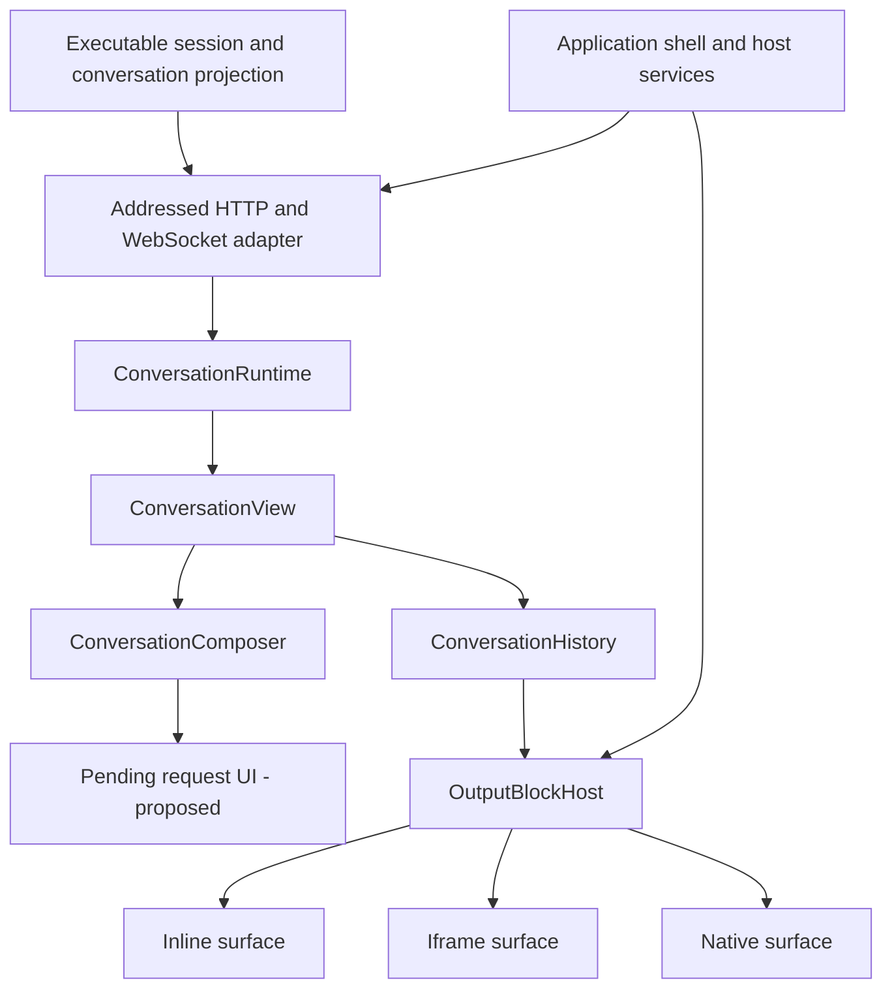

# Standalone Vue conversation UI

Status: stage 1 passive UI prototype implemented, 2026-11-19. Backend projection routes,
capabilities, persisted formats, and stages 2–5 remain proposed. The existing VS Code frontend and
frontend v1 contract continue to describe shipped product behavior.

Maieutics will have a standalone Vue frontend whose reusable unit is one complete conversation. The
conversation contains an ordered input/output history and a current input composer. Outputs are
streams of independently identified blocks. A block can use an inline browser renderer, a separate
iframe, an embedded native control, or an external native window.

The design fixes block identity, state ownership, recovery, and hosting while allowing content
granularity to evolve. Virtual scrolling operates on a flattened presentation sequence, history and
content load independently, and removing a view never implicitly cancels its producer.

Related: [frontend protocol](web-frontend-protocol.md),
[streaming output rendering](streaming-output-rendering-design.md),
[Vue UI and forms](custom-ui-framework-design.md), and
[backend Vue migration](vue-reactive-ui-migration.md).

## Implemented prototype

[`deno/maieutics-ui`](../deno/maieutics-ui/README.md) now contains the framework-neutral projection,
bounded metadata/content caches and source requests, independent view drafts/selection, and an
embeddable Vue conversation component. A lazy fixture source supplies 10,000 turns/100,000 entries
without materializing their full index in the browser. The module builds a self-contained ESM with
an imperative mount adapter and a separate loopback-only demo; it is not embedded as a REPL child.

`ConversationHistory` and `ConversationComposer` are separate exported Vue components and have
separate ESM mount adapters. They can occupy different containers and share one caller-owned view
attachment. History unmount cancels its reads and releases visibility/selection pins; composer
unmount preserves the shared draft. Neither disposes the supplied view or runtime. The optional
`ConversationView` wrapper only creates/releases a view attachment, composes the components and
forwards their events. Rebinding either component changes its local lifetime without destroying
the old caller-owned view.

The prototype renders inert text, lazily expanded activity details, and an independent composer. It
supports range-based history loading, dynamic row measurement, following/history modes, revisioned
text updates, logical copying across evicted rows, session replacement, and joined request disposal.
TanStack Vue Virtual 3.13.52/Virtual Core 3.19.11 use the existing Vue 3.5.13 runtime. The local
source port is deliberately separate from a future wire schema; its stable ordinals describe
navigation within an epoch. Pages ahead of the reducer wait for its stream watermark without
advancing global revision/total; cancellation and disposal release that wait. A snapshot predating
request admission or overflowing reconciliation gets one fresh-snapshot retry, with persistent
inconsistency then failing explicitly. Pending snapshots reconcile bounded successor changes before
entering the resident window. Admission fails atomically if it would retain no requested records.
Concurrent initialization chooses one baseline in a synchronous publication, without an intervening
await. Later initial replies cannot publish state older than that chosen baseline. Stream catch-up
has a configurable failure deadline (15 seconds by default), observable request progress, and a
cancel/retry control that replaces the current range request. Expiry reports `stream_wait_timeout`,
never successful completion. Fragment/range capacity has its own diagnostic, independent of view pins.

A page commit is the cancellation linearization point. Cancellation before it prevents publication;
cancellation raised by a notification listener after commit leaves the completed request successful.
The owned task records that synchronous commit before notifications, so its final cancellation check
cannot report an already published page as cancelled. Tests cover ignored source cancellation, the
delivery-to-commit boundary, and cancellation from the publication listener itself.

The shared text cache remains bounded even when active views pin more exact text than it can hold.
A valid read still returns its full bounded text to the mounted caller when cache admission fails;
retaining that response is optional. Caller-owned mounted windows and the per-content character
limit bound those live responses separately from the shared cache. Cache pressure never becomes
a visible body-read failure. Logical copy retains its separate byte bound and rejects non-integer,
non-finite or unsafe ordinals before reading historical pages. Cross-bundle diagnostics use stable
error codes. Persisted demo page transitions preserve its runtime until a final non-persisted close.

Actual viewport intersection drives unloaded-range admission, including scrollbar-only jumps and
movement inside a range that is already mounted. A changed target cancels the old page request;
range mount and wheel/key events alone are insufficient loading triggers.
Page completion does not navigate to a row. A bounded ordinal geometry snapshot holds scroll extent,
row coordinates, and fractional entry offsets stable during a scrollbar gesture, even as newly loaded
pages replace gaps and measured entries are evicted into gaps. Measurements and anchor corrections
resume on release around the final logical position. Native scroll/scrollend covers platforms whose
scrollbar controls consume pointer events.

Core tests cover ordered/atomic changes, replay gaps, late snapshots, capacity bounds, cancellation,
independent drafts, and complete-or-failed copy. Real browser conformance additionally covers
variable-height virtualization, lazy details, streaming text, native Selection/copy, session
replacement, sibling/runtime closure, and the independently bundled ESM. Resize measurements are
scheduled on animation frames instead of suppressing ResizeObserver feedback warnings. This is
behavioral conformance, not a measured performance claim.
The non-frozen anchor test deliberately evicts previously measured predecessors and compares the
same visible block's screen offset. The following test checks the actual measured viewport bottom,
including growth beyond overscan. Independently removing either correction makes its assertion fail.
The anchor case first awaits the explicit `anchorRestored` acknowledgement emitted after the queued
scroll write, then checks measured geometry. Committed source hashes, mutation replacements, exit
codes and failure excerpts are recorded in
[`scroll-mutations.json`](../deno/maieutics-ui/test/evidence/scroll-mutations.json); the anchor mutation
keeps the acknowledgement intact while removing only the scroll write. Held-page fixtures settle
on request abort, with an injected early-failure scenario proving disposal does not wait for the
runner's outer timeout.

There is no live kernel adapter, pending-input UI/registry, session-owned producer publisher,
presentation journal, Markdown/SSR integration, form checkpoint implementation, executable iframe,
or native bridge yet. The corresponding contracts below remain the implementation requirements for
the subsequent stages. The fixture's submit/append/seal controls do not call models or tools.

## Decisions

1. Ship one embeddable `ConversationView` with a separate, explicitly owned conversation runtime.
   The application shell supplies the addressed session connection and host services.
2. Keep the executable authoritative for canonical history and for the conversation projection it
   publishes. Vue components contain presentation state, not the authoritative conversation.
3. Initially make one assistant message, permitted reasoning summary, tool invocation, rich display,
   or child-run summary one semantic output block. A transport chunk never creates a block merely
   because it arrived separately.
4. Separate semantic blocks, presentation units, and rendering surfaces. A block may later expose
   several independently virtualized units without changing its semantic identity.
5. Use one main scroll viewport for the conversation, with a composer outside that viewport. Flatten
   inputs, output units, and interaction decorations into virtual rows.
6. Add paged conversation projections with an atomic snapshot/subscription boundary. The canonical
   transcript remains a separate API and never becomes a store for UI state.
7. Reuse the existing output compiler, SSR service, browser output client, resource plane, and
   approved form/Actor/HTTP integrations through adapters.
8. Put admitted custom executable output in an iframe. Product-owned passive content and trusted
   built-in controls can render inline. A browser host defaults authored output to passive previews;
   automatic authored execution requires verified host isolation and termination capabilities.
   Native implementations consume semantic data and actions; arbitrary Vue source continues to need
   a browser runtime.

## Conversation structure

```text
Conversation
  Interaction*                       committed display order
    Input                            submitted text and attachment references
    OutputStream
      OutputBlock*                   stable identities, mutable contents
  Composer                           current local draft
  PendingInputRequests               approvals, elicitation, stdin
```

An ordinary submission creates one Agent turn under the existing single-run gate. Commands and
explicit REPL submissions use their existing execution paths and can have display interactions
without becoming Agent transcript turns. A rich display remains attached to its originating
interaction when an explicitly registered session/document-owned producer updates it after an Agent
run ends. A run-owned producer ends with its run.

The composer can hold a new draft while a run is active. Direct submission retains the current typed
`agent_busy` behavior. Sending to the existing server-owned queue is a separate explicit action; the
UI never creates a second local execution queue. Drafts are scoped by session and view, so opening
two views shares conversation state while allowing independent edits and scroll positions.

Pending input requests have a conversation-level projection. Their original blocks can show context,
but the application also exposes pending requests near the composer. A virtualized or collapsed tool
block must never hide the only way to answer an approval or stdin request. Password input stays
ephemeral and is excluded from checkpoints, journals, previews, and logs.

## Ownership and component boundaries



`ConversationRuntime` owns decoding, ordered projection reduction, page/content loading, bounded
caches, submission tracking, and the connection lifetime. Its core uses plain TypeScript and Web
platform types and has no Vue, DOM, VS Code, or native-window dependency. A Vue binding exposes
stable readonly snapshots and narrowly scoped subscriptions; receiving a text delta must not
invalidate the whole conversation component tree.

`ConversationView` accepts an addressed runtime, host services, and appearance options. It emits
navigation, attachment-open, and host-action intents. It neither launches the executable nor reads
discovery files, stores credentials, selects a foreground session, or creates global connections.
The shell explicitly creates and disposes the runtime. Several views can share one runtime through
owned view attachments; releasing one view does not dispose another view's session connection.

`ConversationHistory` owns row geometry, page windows, scroll anchors, selection/copy, and visibility.
`ConversationComposer` owns draft editing and submission intents, without history or clipboard
dependencies. They must remain independently mountable components. A shell can attach a view once
and supply it to both components in separate layouts, retaining responsibility for its disposal.
Each component owns and cancels its local work when unmounted or rebound; neither closes the shared
view. Closing that view disables input and retires history subscriptions, so later runtime updates
cannot repopulate a closed history. The optional composition wrapper owns its one attachment.

`OutputBlockHost` owns one inline/embedded presentation attachment, or a preview attachment referring to an external
window owned by the shell's window registry. It chooses a surface using host capabilities and
content authority. Output renderers own only their assigned subtree or surface. No renderer changes
the surrounding conversation layout except through bounded size reports.

The proposed implementation starts in one new Deno workspace member, `deno/maieutics-ui`, with
`core/`, `vue/`, `surfaces/`, and `hosts/` directories. These are responsibility boundaries inside
one module. Existing output-client and renderer modules retain their ownership. Backend work belongs
in `Maieutics.Frontend`, with storage adapters in `Maieutics.Persistence`; no new .NET assembly is
needed.

## Blocks and presentation units

The following types describe the model, not a finalized wire schema:

```ts
type BlockKind = "message" | "reasoning-summary" | "tool" | "display" | "child-run" | "diagnostic";

interface BlockDescriptor {
  readonly id: string;
  readonly interactionId: string;
  readonly orderKey: string;
  readonly kind: BlockKind;
  readonly contentRevision: string;
  readonly sourceState: "open" | "sealed";
  readonly outcome?: "completed" | "failed" | "cancelled";
  readonly content: ContentReference;
  readonly preview: string;
}

interface PresentationUnit {
  readonly id: string;
  readonly blockId: string;
  readonly contentRevision: string;
  readonly rendererKey: string;
  readonly restoration: "reconstructible" | "checkpointed" | "ephemeral";
}
```

All identities are session-scoped opaque values. The projection maps existing run/message/call/
display identities to stable block identities. A block occurrence is distinct from a shared business
model: two blocks can show the same form model while retaining separate editing drafts and view IDs.
`orderKey` represents immutable first-appearance order assigned by the server, not an array index or
timestamp. Content changes preserve that order. Forked sessions have their own identity scope and
map inherited display provenance explicitly.

Metadata and previews are bounded, rendered as inert text, and carry no executable factories or
credentials. Content references resolve through authenticated product APIs; binary content remains
an object/resource reference. The selected renderer, active surface, expanded state, measured
height, and scroll position belong to a view and are absent from canonical Agent history.

Each block has a monotonically increasing content revision. Text append operations identify both the
required base revision and the resulting revision. Tool state and rich-display replacement initially
use complete bounded snapshots or content references. Generic object patches and HTML patches are
unnecessary for the first version. New source supersedes the previous source; only an explicit
matching base permits an append.

Run termination, source sealing, producer closure, render application, and view disposal are
separate transitions. A sealed message can still be rendering; a completed run can leave an
independently owned display producer alive. Cancellation preserves received partial display output
according to existing semantics and stops that run's owned work. It does not infer completion from
an animation, a quiet socket, or a rendering delay.

### Initial granularity

| Output                      | Semantic block                                   | Initial presentation units                        |
| --------------------------- | ------------------------------------------------ | ------------------------------------------------- |
| Assistant text              | One provider-neutral message                     | One document                                      |
| Permitted reasoning summary | One summary message                              | One collapsed activity region                     |
| Tool call                   | One invocation, including progress and result    | One activity region; expanded details load lazily |
| Rich display                | One display occurrence                           | One chosen representation                         |
| Child run                   | One child summary under its invoking interaction | Summary, then lazily expanded child entries       |
| Local/request failure       | One typed diagnostic where appropriate           | One diagnostic region                             |

The next granularity step splits long passive documents at compiler-recognized semantic boundaries.
Reference definitions, list context, headings, tables, and other document-wide dependencies stay in
the document model. Splitting on blank lines or reparsing independent paragraph strings is not a
valid implementation. Vue setup, slots, conditional subtrees, and component context stay together
unless the compiler can preserve their semantics across a split.

Unit identities survive source reconciliation while the logical unit survives. A split or merge
provides an explicit mapping for anchors and retires the superseded IDs. Token chunks, text hashes,
heading slugs, and current row indexes are unsuitable identities. A monolithic interactive surface
can instead declare a bounded viewport with internal scrolling; this is an explicit renderer
capability rather than an automatic nested scroll container for every block.

## Virtual scrolling and lazy loading

### One flattened sequence

The viewport sees input rows, block units, activity summaries, and bounded loading/unavailable
ranges. Turn grouping is decoration over those rows. Virtualizing entire turns would leave one large
turn with unbounded mounted output, so an enclosing turn component must not be the only
virtualization boundary.

Use `@tanstack/vue-virtual` behind a small local viewport adapter for the initial implementation.
Its Vue adapter, stable item-key hook, and dynamic measurement APIs cover the required integration
points. Deno bundling, the repository's pinned Vue runtime, variable-height prepending, and browser
behavior still need the first implementation spike; no package installation or compatibility result
is implied here.
[Vue performance guidance](https://vuejs.org/guide/best-practices/performance.html#virtualize-large-lists)
supports list virtualization, and the
[TanStack Vue adapter](https://tanstack.com/virtual/latest/docs/framework/vue/vue-virtual) and
[virtualizer API](https://tanstack.com/virtual/latest/docs/api/virtualizer) define those hooks.

The adapter owns measurement integration, not conversation state. Every row uses its stable unit
identity as the virtualizer key. One geometry coordinator applies anchor corrections; browser,
library, and application anchoring must not independently compensate the same resize.

### Three independent loading stages

1. Load an index page containing inputs, block descriptors, and range cursors. It must not load
   every transcript, output source, rich object, or component bundle.
2. Load block content when it enters the prefetch window or a user explicitly expands/navigates to
   it. Cancel obsolete requests and bound concurrency; collapsed tools need only their summaries.
3. Load renderer code, media, and interactive attachments when the chosen unit needs them. Reuse
   offline shipped assets and cached immutable resources.

Prioritize visible pending requests and focused blocks, then other visible content, nearby content,
and speculative prefetch. Network receipt and ordered reduction continue when no output is mounted.
For an uncached block, consuming an update advances the stream cursor and any resident descriptor
without retaining its body. Its next mount obtains a current snapshot. An entirely unloaded range
does not create one new cache entry per observed block. This is deliberate cache invalidation, not
event loss.

Evict old index pages as well as bodies. Retain bounded range markers, navigation cursors, and
estimated aggregate heights so loading a long conversation does not eventually materialize its
entire index in browser memory. An offscreen block changing size is remeasured on demand. Window
resizing invalidates affected geometry estimates without recompiling output source.

### Scroll policy

Store an anchor as session epoch, unit ID, a content location where available, and pixel offset
inside that unit. Keep cached geometry keyed by content revision, available width, and style/font
generation. Passive documents can supply a source/text location for more accurate restoration after
width changes; opaque surfaces restore using their checkpoint and measured offset.

Before prepending pages or applying measured height changes, capture the anchor. After the logical
update and measurement, restore it. If the anchored unit was removed, use its declared successor,
then predecessor. Do not guess that a new row index denotes the same content.

Track two explicit modes: following the live end and reading history. User movement away from the
end enters history mode; new content then updates a new-output indicator without moving the reader.
An explicit jump-to-latest or return to the end enables following again. Page loading, iframe size
reports, font changes, and late image loads all use the same anchor policy. Avoid smooth scrolling
while correcting unknown or changing geometry.

During a native scrollbar gesture, user input owns the viewport position. Freeze aggregate extent
and the current bounded geometry, including measured deviations retained inside unloaded ranges.
New pages may replace placeholders and lazy bodies may finish, but neither page completion nor row
measurement may write a scroll correction or change the thumb's coordinate system. On release,
remeasure and restore the final logical unit and intra-unit offset. Fence queued restoration against
new navigation and disposal. Use scroll/scrollend as a fallback when native controls do not forward
pointer events, and distinguish application scroll writes from user movement.

Focused editors and IME composition temporarily pin their units. Resolve or transfer focus before
retiring a pinned surface. Keyboard navigation mounts its target and waits for the surface's
readiness acknowledgement before focusing it. The virtualized history retains document/list
semantics; streaming announcements use a separate bounded live region instead of announcing the
entire list after each delta.

### Selection and copying

The conversation owns cross-block selection as a logical range with direction, stable unit IDs,
content revisions, and offsets into each renderer's text representation. Only its endpoints and the
actual focus/IME unit require pins; intermediate selected units can be evicted. Native DOM Selection
is a local projection of that range, not the authoritative selection. Range extension through
unloaded history loads bounded index pages without mounting the whole selection.

Ordinary copy resolves the selected text at the captured revisions from the renderer's text
projection and content store. It does not read only the surviving DOM or copy raw Markdown where the
user selected rendered text. Collapsed details stay excluded. Updates reconcile text anchors where
the renderer can map them; otherwise retain the selected revision within the selection budget, or
report stale/unavailable selection instead of copying different or incomplete text. Copy-all,
export, and search likewise operate on content/index APIs.

Cap retained selection material and a single ordinary copy at 8 MiB. If resolving a range exceeds
that budget, keep the logical endpoints and offer bounded export or a smaller selection; do not
mount or pin every intervening block. An unavailable historical range produces an explicit failure
rather than a successful partial copy. The clipboard adapter preserves this behavior for keyboard
shortcuts and the host's ordinary copy command.

Iframe and native controls own their internal selections. They join conversation-level selection
only through an explicit revisioned text/offset adapter. Otherwise cross-block selection exposes
their declared textual fallback or a visible non-text boundary; it never invents a DOM range across
separate documents or silently omits selected content.

### Initial resource budgets

These are proposed tunable defaults for the first prototype, not measured capacity guarantees.
Server limits remain authoritative and may narrow them.

| Resource                              | Initial client budget                                         | Exhaustion behavior                                                      |
| ------------------------------------- | ------------------------------------------------------------- | ------------------------------------------------------------------------ |
| Index page                            | 80 entries, server maximum 200                                | Continue with an explicit cursor, including within a large turn          |
| Resident index                        | 2,000 descriptors                                             | Evict distant pages into reloadable range markers                        |
| Unloaded range markers                | 128                                                           | Coalesce adjacent ranges; preserve the current anchor and reload cursors |
| Cached source/data bodies             | 32 MiB                                                        | Evict unpinned bodies; retain references                                 |
| Cached rendered material              | 32 MiB                                                        | Evict derived material; preserve the last bounded preview where possible |
| Mounted units                         | 64, with at most four extra focus/IME/selection-endpoint pins | Reduce overscan and present placeholders; never steal focus silently     |
| Selection material and ordinary copy  | 8 MiB                                                         | Keep logical endpoints and offer bounded export or a smaller selection   |
| Retained offscreen ephemeral surfaces | Eight, within the total surface budget                        | Freeze an eligible old view and require explicit interactive resume      |
| Live iframes                          | Four, within the total surface budget                         | Leave additional units as previews with an activation control            |
| Content/render requests               | Four content loads and two render requests                    | Queue visible work first; cancel obsolete prefetch                       |
| Snapshot reconciliation buffer        | 4 MiB per conversation attachment                             | Abandon the stale snapshot and request a fresh bounded range             |

Loaded native controls also require a host-advertised finite lease budget. An active native text
editor consumes a focus pin. A renderer whose single unit exceeds available limits must offer a
bounded preview, paged/windowed representation, or explicit unavailable state. Never truncate the
authoritative source to satisfy a view cache limit.

## Surface contracts

`OutputBlockHost` selects from product-installed surface adapters using content kind, approved
renderer identity, supported format, available host capabilities, and the user's placement choice.
Model output cannot name an arbitrary executable module, native process, or privileged host API.
This is a host adapter boundary, not a revival of the retired custom component-family framework.

The portable binding contains session/block/unit identities, source and presentation generations,
the current snapshot, resource references, theme/locale, a validated view checkpoint, and scoped
action capabilities. The web adapter receives its DOM element locally; native adapters receive their
platform target locally. Those target handles never enter the portable binding or wire.

All surfaces support attach, apply a revisioned snapshot, acknowledge an applied revision, report
preferred size, update visibility/viewport, request focus, export a supported checkpoint, and
detach/dispose. Every reply carries the attachment generation. Retired attachments cannot send
actions, change layout, or acknowledge work for their replacements. Readiness is a protocol event;
creating an iframe or sending a message does not establish a committed presentation.

Sizes use CSS pixels plus a layout generation identifying width, font/theme state, and scale. Clamp
invalid or excessive sizes. The parent owns positioning and clipping. Viewport telemetry is
latest-state data and can be sampled; semantic content updates and user actions remain ordered and
cannot be silently coalesced. The surface has no authority to scroll the whole conversation except
through an explicit navigation intent.

### Inline browser surface

Render product-owned Vue controls and passive output inline, with explicit subtree ownership and
scoped styles. Reuse `maieutics-output-client` for Markdown fallback, SSR application, diagnostics,
progressive output, and forms. The conversation build should share its pinned Vue dependency through
source-level integration. The existing self-contained output ESM remains available to VS Code and
other hosts; Vue refs, component instances, or provide/inject state never cross between separately
bundled runtimes. Verify runtime deduplication in the frontend build.

Apply the existing HTML, URL, and CSS content policy; SSR does not make authored HTML trusted. No
DOM merger traverses a Vue-owned subtree. Local UI drafts need a checkpoint adapter before forms can
be freely recycled; the current output client does not yet expose a generic view checkpoint API.

### Authored execution policy

Iframe origin and permission isolation do not guarantee a separate implementation thread or
preemptible execution. A client-only hook such as `onMounted(() => { while (true) {} })` can pass
SSR and then block the browser UI; a timer in that UI cannot provide a dependable watchdog. The
[HTML event-loop model](https://html.spec.whatwg.org/multipage/webappapis.html#event-loops) permits
multiple window event loops to share an implementation thread.

The default browser host automatically renders passive previews through the Markdown/data-template
lane and product-owned controls; it does not select live Vue compilation/hydration automatically. It
offers an explicit activation action for eligible authored components only when its content and
capability policy permits execution. This browser mode does not promise that in-page stop controls
will remain usable during arbitrary authored script. A new script/setup epoch or retired execution
attachment requires renewed explicit activation; scrolling does not activate code. Template-only
progressive updates inside the same authorized setup epoch retain that activation.

A host may enable automatic authored hydration only after independently demonstrating protected
control execution and the ability to terminate the surface without scheduling work in its blocked
renderer. The host supplies an independently owned watchdog, a total termination budget, and a
generation fence for late results. An iframe, opaque origin, or separate window alone does not
establish these capabilities. Failed isolation/termination conformance leaves automatic execution
disabled. Existing provenance checks remain necessary in every mode.

### Iframe surface

Use a product-owned wrapper with an opaque sandboxed origin for admitted custom executable output.
The initial profile enables scripts without `allow-same-origin`; network, navigation, popup,
clipboard, and other browser capabilities are constrained by parent/child CSP and host policy. No
frontend bearer token, plugin gateway credential, or unrestricted Fetch bridge enters the frame.
Resource access and actions use the attachment's narrow host capabilities. Existing approval and
component provenance rules still apply.

Bootstrap a dedicated `MessagePort` only for the expected iframe window and current attachment. The
parent checks `event.source`, wrapper readiness, and a fresh attachment challenge; an opaque `null`
origin alone is never an identity check. Opaque frames require `targetOrigin: "*"` for this initial
transfer, so transfer only the scoped port and non-secret bootstrap data to that exact window. A
host using a dedicated non-opaque origin instead validates the exact origin as well. Subsequent
communication uses the private port, versioned envelopes, request IDs, limits, and generation
checks. Complete the wrapper handshake and install the attachment policy before executing authored
code. Navigation, reload, detach, or wrapper failure retires the port and its grants. These
constraints follow the platform's
[postMessage origin and source semantics](https://developer.mozilla.org/en-US/docs/Web/API/Window/postMessage)
and
[iframe sandbox behavior](https://developer.mozilla.org/en-US/docs/Web/HTML/Reference/Elements/iframe#sandbox).

Sandboxing and child-document CSP alone do not establish a network/navigation boundary: a frame can
navigate itself, and revoking its port after `load` cannot undo an outgoing request. The host must
specify parent `frame-src`, child resource/connect/form policies, wrapper URLs, redirect handling,
and allowed navigation for its supported engines. Verify self-navigation and redirects before
admitting authored execution. If the required restrictions cannot be enforced, retain a passive
preview; explicit activation cannot override the owning scope's policy.

The wrapper receives verified render material and data, mounts its own Vue runtime, and reports size
and application acknowledgements. Binary resources use transferred buffers or owned bounded byte
streams, never base64 or JSON arrays of bytes. Hiding a frame can pause view-only rendering;
disposing it releases its subscriptions without closing a shared producer.

### Native surfaces

A native renderer implements a declared semantic block format and action schema. A table model could
have both a Vue renderer and a native grid; a model-authored arbitrary Vue component has only a
browser renderer unless someone supplies a corresponding semantic representation.

Support two placements. An embedded native control reserves a measured slot; the host must provide
scroll/clip/scale synchronization, focus traversal, IME, and accessibility integration. A separate
native window leaves a bounded preview/open/focus control in the conversation.

The application shell's window registry owns an `ExternalSurfaceScope` for that window, with its own
view ID, attachment generation, cancellation/completion, finite lease, and disposal path. It holds a
conversation-runtime reference and backend view attachment independently of any preview row. The
preview's `OutputBlockHost` owns only that row's attachment and forwards open/focus intents to the
registry. Evicting the preview or closing/repinning its conversation view leaves the window attached
to its original session. The runtime cannot suspend its connection while an external window still
holds a live reference.

Window close releases that scope and its runtime/backend leases without closing a shared business
model. Source session closure, source block deletion, applicable permission revocation, or invalid
model/component generation revokes the window's interactive capabilities immediately and closes the
owned window within its shutdown budget. Registry shutdown joins every scope. A replacement window
receives a new generation; late actions and replies from its predecessor are rejected.

Browsers lacking a native bridge advertise that fact and use a web renderer or preview. The initial
deliverable is a browser-hostable conversation component; selection of a desktop shell and native
toolkit remains a deployment decision. Native capability is never simulated by launching a process
from arbitrary block data.

## View state and restoration

| State                                          | Owner                                   | Restoration                                                           |
| ---------------------------------------------- | --------------------------------------- | --------------------------------------------------------------------- |
| Canonical conversation and run state           | Executable Agent/session                | Existing transcript and lifecycle semantics                           |
| Business model and producer                    | Existing approved owning worker/service | Explicit model attachment; never reconstructed by replaying actions   |
| Display history and block source               | Executable conversation projection      | Paged projection and content snapshots                                |
| Composer, expansion, scroll, local form drafts | View attachment                         | Bounded frontend state keyed by session/view/block and schema version |
| DOM, Vue effects, iframe/Actor connection      | Surface attachment                      | Recreate or explicitly resume according to restoration policy         |

`reconstructible` units rebuild safely from a snapshot. `checkpointed` units export a bounded,
versioned, validated data checkpoint and restore it before enabling interaction. `ephemeral` units
have non-exportable state. Authored Vue refs and closures are ephemeral unless the component
explicitly implements a supported checkpoint contract; serializing arbitrary Vue internals is not
part of this design. Restoration classification or a saved activation flag never grants execution
authority; every reconstruction still obeys the current host policy and source/setup epoch.

### Form draft checkpoints

A form checkpoint binds session/view/model identity, model generation, schema version, the last
confirmed server baseline and its revision, and each field's draft/dirty state. Preserve missing
versus present values explicitly. A detached draft is never treated as the current business model.
Reattach to a confirmed current model snapshot before merging or enabling submit.

Use the existing live-form policy that a server change to a field takes precedence over its old
draft. Three-way restoration compares the checkpoint baseline, the local draft, and the current
server state. Removed fields disappear; unchanged clean fields use current server values; dirty
fields retain their draft only when the server field is known unchanged since the baseline. A
server-changed field adopts its current value and retains any displaced local draft as a bounded,
explicit conflict for review. Restoring or resolving a conflict never submits a business action.

An overall model revision or equal current values alone cannot prove a dirty field was unchanged:
the server may have changed a value and then changed it back while the view was detached. The
checkpoint adapter needs field change revisions or complete intervening change evidence. Without
that proof, keep the dirty draft as a conflict instead of silently reapplying it. Schema/model
generation mismatch invalidates automatic restoration; incompatible data may only remain inert local
draft material under the same limits and sensitive-data policy.

After merging, derive dirty fields against the new confirmed baseline. The `{a:A0,b:B0}` baseline,
local `{a:A1,b:B0}` draft, and server `{a:A0,b:B1}` state must restore `{a:A1,b:B1}` when field `a`
is proven unchanged. Also cover concurrent edits to `a`, change-and-change-back, field removal,
schema change, and reconnect gaps. These capabilities must be implemented in the form adapter before
a mounted form is classified as checkpointed and freely recycled.

### Ephemeral state and invalidation

Keep a bounded number of offscreen ephemeral surfaces alive. When that budget is exhausted, freeze
an unfocused eligible surface into a passive preview. On return, indicate that its local interactive
state was released and offer explicit resume. Do not silently recreate arbitrary setup code on every
scroll. View-only setup may run during explicit reconstruction under the existing provenance rules;
producer creation, model calls, tools, and business actions are never replayed.

View checkpoints are untrusted input with schema/size limits. Sensitive drafts remain memory-only.
Session repinning, approval revocation, worker generation change, and component generation change
invalidate the corresponding capabilities and any incompatible checkpoint. A readonly historical
form snapshot does not acquire a live attachment merely because the same model ID exists now.

## Conversation projection and backend changes

The current transcript endpoint returns committed provider-neutral messages as one snapshot. It does
not preserve all reasoning summaries, failed-run display output, or rich presentation state. The
existing run-scoped replay buffer is bounded. A standalone UI therefore needs a separate
conversation projection for paged display recovery; fetching the full transcript and slicing it in
the browser does not meet the lazy-loading requirement.

`Maieutics.Frontend` owns a per-session projection with explicit inputs from run dispatch,
longer-lived presentation producers, and request owners. It publishes input/block descriptors,
source revisions, run state, pending requests, and session/queue summaries. It does not contain
provider SDK objects, private reasoning, rendered DOM, component instances, or executable factories.

Each projection has an epoch and a strictly increasing session-level revision. Rebuilding the
projection changes the epoch. Run-local event sequences retain their existing meaning and can be
recorded as origin information; they cannot order an entire multi-run conversation. Revision and
ordinal values use decimal strings on the wire to avoid JavaScript integer precision loss.

### Publication ownership

Agent events reach the projection through the existing owned run dispatcher as an additional sink,
never through a competing consumer of `IAgentRun.Events`. Its terminal fence remains unchanged: the
terminal/idle pair is the final publication on that run's existing event stream.

Cross-run display updates use a separate session/document-owned presentation publisher, with a
producer scope registered by the executable's authorized producer path. Registration fixes session,
originating interaction/block identity, producer ID/generation, policy, quotas, and lifetime. A
frontend view or source marker cannot promote a run-owned producer into this scope. The owning
service/worker retains cancellation, observed completion, and deterministic release; run completion
does not detach a registered session-owned publisher.

That publisher writes directly into the conversation projection, independently of
`FrontendRunStream` and its run-owned presentation router. Updates preserve the originating block
but do not reopen a run or append frames after its terminal pair. Producer close, session/document
close, permission revocation, and generation replacement settle its pending work and reject stale
publications. Existing run-owned displays freeze when their scope ends; there is no implicit
lifetime extension. Stage 2 must supply this separate path before advertising cross-run display
updates. Its internal endpoints/contracts require the same explicit direction, authentication,
limits, and binary/resource handling as the existing product APIs.

### Pending input ownership

A session's pending-input registry receives owner-authorized lifecycle transitions from the existing
stdin, elicitation, and approval owners. Observing `input.request` frames alone is insufficient: the
owners must publish creation and exactly one terminal transition on answer, denial, cancellation,
expiry, or owner closure. They retain authority to validate and complete the request; the registry
is their versioned display projection, not a second completion mechanism.

Each record identifies session, request kind/ID, originating interaction/run, owner scope and
generation, deadline where applicable, and pending or terminal status/cause. Answer values and
passwords do not enter that record. State transitions enter the session projection's serialized
writer before the corresponding completion/answer is acknowledged; bootstrap captures the same
revisioned state as the successor stream. Complete waiters and perform I/O outside locks. Keep
terminal receipts bounded and expose only genuinely pending records as answerable in snapshots.

Two views answering one request race at its owner: one answer wins; the other receives the existing
already-resolved/not-found outcome and never replays the action. Both views consume the terminal
projection transition. Reconnect recovers current state without extending deadlines, reissuing an
input request, or turning a historical request into a new live capability.

Unmounting an output, closing a view, or losing its subscription releases only that view's
attachment. It must not call the run router's presentation-scope detach. A true request owner/scope
ending follows existing v1 stdin/elicitation cancellation and tool-approval denial/deadline rules
and publishes the resulting terminal state. Existing v1 requests stay run/scope-bound; cross-run
display support does not make these requests survive their owner. Any future longer-lived input kind
needs its own explicit owner and versioned contract.

### Proposed API surface

Discovery adds `conversationView: {version: 1}` when the implementation is ready. These paths are
design reservations under the existing authenticated frontend host, not current v1 endpoints:

| Operation                                                                   | Purpose                                                                                                                |
| --------------------------------------------------------------------------- | ---------------------------------------------------------------------------------------------------------------------- |
| `POST /v1/agent/sessions/{sid}/view/attachments`                            | Atomically acquire a bounded subscription lease and the newest index page at revision R, with active/pending summaries |
| `GET /v1/agent/sessions/{sid}/view/events?attachmentId=...&afterRevision=R` | Server-to-client WebSocket of ordered projection changes                                                               |
| `GET /v1/agent/sessions/{sid}/view/entries?before=...&limit=80`             | Older index page; `after` or `around` is an alternative navigation mode                                                |
| `GET /v1/agent/sessions/{sid}/view/blocks/{blockId}`                        | Current bounded block-content snapshot or references; optional `contentRevision` requests an exact retained version    |
| `DELETE /v1/agent/sessions/{sid}/view/attachments/{attachmentId}`           | Release the attachment and its pending work idempotently                                                               |

Cursors bind session, epoch, immutable entry order, and direction. Page replies include the captured
revision, continuation cursors, and explicit availability/retention information. Pagination can stop
inside a large interaction. New tail entries cannot shift the meaning of an older-page cursor.
Deleted or evicted ranges are visible as unavailable ranges rather than silently missing history.
All cursor validation, page sizes, leases, replay, frames, and content sizes are bounded.

An exact-revision content read returns that version or a typed unavailable result; it never silently
substitutes current content. Selection uses these reads or immutable content references within its
retention budget. Historical reads populate only the versioned content/selection cache and cannot
replace current block state or advance its snapshot/stream watermarks. Server history retention
remains bounded; a selection does not create an unlimited historical pin.

The projection stream carries atomic change batches: input/block insertion or metadata replacement,
revision-checked text append, content-reference replacement, explicit removal, and lifecycle/request
state. It never carries HTML patches or unscoped business-model RPC. Preserve all published ordered
changes. Publish started/busy state before associated run output and terminal state before idle,
retaining the existing run-local ordering. Later publications from a separately owned producer are
session presentation changes, not additional frames of an ended run. Rendering may apply several
consumed text changes in one animation-frame update without altering their semantics. Unknown
optional fields are tolerated; an unsupported operation leads to explicit recovery or a compatible
readonly fallback, not a crashed receive pump.

### Snapshot and subscription consistency

1. Under one short projection gate, capture an immutable index root and revision R and register a
   lease whose successor retention starts at R+1. Release the gate, then read the initial page from
   that captured snapshot outside the gate. Snapshot read leases also have finite budgets.
2. The client opens the stream using that lease. Publish R+1 onward exactly once into its reducer;
   duplicate delivery is recognized by epoch/revision. Retention exhaustion or attach deadline
   expiry invalidates the lease with a typed gap instead of allowing a partial catch-up.
3. On reconnect, resume from the last applied projection revision. A gap or changed epoch triggers a
   fresh attachment, anchored around the last visible content where available. Runtime recovery does
   not submit another turn or issue business actions.
4. An additional page/body load captures its own revision S. While it is pending, retain a bounded
   suffix of consumed changes. Merge the snapshot and replay changes newer than S for that range.
   Never overwrite newer cached state with an older snapshot. If the required suffix exceeds the
   reconciliation budget, discard that reply and refresh the affected range.

Page/body watermarks apply only to their captured records. They never advance the global stream
cursor past unconsumed lifecycle or request events. A block already loaded at S ignores superseded
body operations through S while the reducer still consumes their stream envelopes in order.
Distinguish invalid cursors, expired leases, replay gaps, changed epochs, and unavailable content
with typed recovery causes rather than a generic loading failure.

Backpressure closes the subscriber with an explicit recovery cause. Projection ingestion and backend
owners use bounded queues and observed tasks; they never silently discard semantic events. Rendering
and media loading cannot block the connection reducer. Subscriber overload does not stop the Agent
run or another subscriber.

### Display persistence and degradation

When existing runtime persistence is enabled, add a versioned presentation journal through the
existing persistence composition. Store safe block source/data snapshots, stable order/provenance,
and terminal display state separately from canonical transcript rows. Maintain a bounded replay
tail; older history uses indexed latest snapshots rather than replaying every token. Binary data
stays in the object store, with projection references participating in reclamation.

The journal has explicit size/retention limits, typed write failures, and crash reconciliation. An
incomplete record is marked interrupted on recovery and never recreates a live producer. Journal
failure must be surfaced as degraded display durability; it cannot corrupt or roll back an otherwise
valid canonical transcript commit. A terminal run display record records the canonical
commit/discard outcome; a restart reconciles it against authoritative history before claiming a
successful committed turn. Display persistence never silently expands what enters model context.

Without runtime persistence, paging is available only over retained in-memory display state. Older
sessions can be projected from their canonical transcript with a declared reduced-fidelity marker;
missing summaries and rich output are not fabricated. Existing notebook snapshots remain portable
files and do not become the runtime database. Executable source provenance is reverified through the
existing rules, and restored snapshots contain no compiled factory or live authority.

## Submission and action correctness

Use the existing session-addressed turn, queue, cancel, input-answer, and approved plugin/form
surfaces. Place stop/cancel outside virtualized history. Dispatching cancellation does not await
content loads, SSR, component startup, or surface shutdown, and the executable's control handling
remains independent of those tasks. A responsive browser event loop is required to dispatch an
in-page click; arbitrary authored script can defeat that condition. Hosts claiming protected stop
controls must meet the independent execution/termination contract above. Render cancellation and
Agent cancellation are separate operations.

Retain a submitted draft until the server confirms acceptance. Track a provisional submission
separately from committed history. Reconcile its eventual run ID and echoed input by an explicit
submission identity; text equality is insufficient. An uncertain transport result is shown as
uncertain and never automatically retried against today's non-idempotent turn/queue endpoints. The
implementation must add a bounded, session-scoped submission receipt/deduplication contract before
enabling automatic retry. Receipts bind an exact request body and report an expired or unknown
outcome explicitly; they do not promise exactly-once execution across arbitrary crashes.

Each surface action carries a request ID and current attachment/model generation and goes through
the owning adapter's allowlisted action schema. A transport acknowledgement is distinct from its
business result. Reconnect restores state without replaying actions. Approval revocation closes
affected attachments and rejects late actions immediately. Generic business action/result RPC
remains the separate work described in the Vue migration roadmap; this UI does not replace existing
forms or HTTP/Actor contracts with an unrestricted block RPC endpoint.

## Structured lifetimes

| Scope                               | Owned work                                                                               | End condition                                                   |
| ----------------------------------- | ---------------------------------------------------------------------------------------- | --------------------------------------------------------------- |
| Application shell                   | Launched executable if any, runtime/window registries, host bridges                      | Explicit application shutdown                                   |
| Conversation runtime                | Projection socket, receive/reduce pumps, page loads, caches                              | Explicit runtime disposal or session closure                    |
| View attachment                     | Composer/drafts, viewport, checkpoint cache, mounted/retained surfaces                   | View close or session replacement                               |
| Embedded/preview surface attachment | Render requests, observers, ports/Actors, embedded handles or external-window reference  | Eviction, replacement, revocation, or owning view close         |
| ExternalSurfaceScope                | External window, independent view/backend leases, runtime reference, bridge and watchdog | Window close, source invalidation/revocation, or shell shutdown |
| Business producer                   | Existing service/worker/model resources                                                  | Its owning scope's completion/cancel/close policy               |

Every asynchronous scope has an AbortController/cancellation source, observed completion, and an
idempotent joined disposal path. Session replacement increments the local attachment generation
before new work can publish. Cleanup uses one total timeout budget; owned child processes can
escalate through existing process supervision. Never hold a projection lock across socket sends,
bounded queue waits, storage I/O, rendering, or process exit.

Closing a conversation view releases its embedded/preview attachments. External window scopes remain
owned by the shell registry. Closing the last view can suspend its runtime connection only when no
external window or other owner holds a live runtime reference; it does not cancel an accepted Agent
run or destroy a shared business producer. Request owners remain independent of subscriber counts
and settle their requests under the rules above. Explicit stop, session close, and application
shutdown have distinct semantics. A standalone shell that launched an executable owns its final
shutdown; attach mode leaves that external process under its original owner.

## Implementation sequence and acceptance

| Stage | Deliverable                                                                                  | Required evidence                                                                                                                                                                       |
| ----- | -------------------------------------------------------------------------------------------- | --------------------------------------------------------------------------------------------------------------------------------------------------------------------------------------- |
| 1     | Pure projection reducer and Vue conversation shell over deterministic fixtures               | Stable block identity/order, independent drafts/views, one viewport, bounded caches, and logical cross-block selection/copy                                                             |
| 2     | Kernel projection, separate producer publication, pending-input registry, and paged recovery | Snapshot/subscription races, late display publication, unique input terminal transitions, reconnect/gaps, epochs, and persistence degradation                                           |
| 3     | Browser host and existing output-client integration                                          | Real kernel/browser streaming, independent cancel dispatch, revision guards, runtime deduplication, passive fallback, and baseline-aware form checkpoint restoration                    |
| 4     | Policy-gated iframe surface and bounded live view retention                                  | Explicit browser activation, protected-host execution/termination if advertised, wrapper handshake, navigation/redirect policy, resize/anchor stability, and stale capability rejection |
| 5     | Long-document units and independently owned native windows                                   | Semantic split/merge preserves document/Vue context; embedded focus/clip lifecycle; external window ownership/revocation, first through a mock bridge and then a real host              |

The first product slice completes stages 1–4 with whole-document message units and passive authored
output by default in the browser host; stage 1 alone is a prototype. Browser activation remains
explicit, and automatic authored execution stays unavailable until a host passes the protected
control/termination checks. Long passive outputs initially use bounded previews or renderer-specific
windowing when they exceed one-unit budgets. Fine document virtualization and a particular native
toolkit can follow without changing semantic block identities or conversation ownership.

Use fixtures with 10,000 turns/100,000 mixed entries, a very large single turn, near-limit source,
continuous text/tool updates, live forms, delayed image dimensions, and width/font/theme changes.
Measure initial usable content, long tasks, frame timing, source/render cache bytes, mounted units,
surface leases, and retained resources after repeated navigation. Capacity claims require recorded
device/browser/build conditions; the budgets above are acceptance constraints, not a performance
benchmark. Adding history must not grow resident client state beyond those budgets.

Regression tests use controlled publication gates, protocol application acknowledgements, observed
disposal completion, and geometry assertions after readiness. Timeouts bound waits; sleeps do not
prove ordering or completion. Include focus/selection/IME, reading-history scroll stability,
prepend/resize, out-of-order render replies, concurrent view closure, uncertain submission, expired
leases, full queues, worker death, readonly snapshot restoration, and native/iframe fallback.

Acceptance must also pin these interleavings and boundaries explicitly:

- Complete a run, then update its registered session-owned display: the conversation receives the
  update while the old run stream remains closed. Ending/replacing that producer rejects late work.
- Answer, cancel, and expire stdin/elicitation/approval requests with two views and a reconnecting
  subscriber. Each sees one terminal outcome; ordinary view detach does not end the request owner,
  while true owner closure settles it. Pending snapshots never revive a resolved request.
- Restore form drafts after changes to another field, concurrent changes to the same field,
  change-and-change-back, missing change evidence, field removal, and schema/generation replacement.
- Extend a selection across more than 64+4 units while scrolling and evicting intermediate rows.
  Ordinary copy returns the complete revisioned text within budget, or an explicit unavailable/
  over-budget outcome. Include iframe/native boundaries and simultaneous focus/IME ownership.
- Deliver a component whose infinite loop runs only in a client mount hook. The default browser path
  does not execute it automatically. Every host advertising protected control must still dispatch
  cancellation and terminate its renderer within the declared total budget; a same-UI timer or
  successful SSR does not establish this result.
- Evict an external-window preview, close/repin the originating conversation view, and close the
  last ordinary view. The external window stays interactive in its original session. Window close,
  source block/session deletion, permission revocation, and shell shutdown release the correct
  leases; stale generations cannot act on a replacement window.

Backend implementation requires focused frontend/product tests, the repository's full test/build
acceptance, and the supported NativeAOT publish check where affected. Deno/browser implementation
requires type/lint/format checks, reducer and adapter tests, real browser/kernel conformance,
offline asset verification, and existing VS Code regressions for any shared output-client change.
Final wire schemas, capability discovery, persisted-format migrations, and representative
compatibility fixtures must be updated when each contract is implemented.

## Remaining implementation choices

The semantic block defaults, flattened virtualization, snapshot consistency, surface boundary, and
ownership rules above are the baseline design. Implementation spikes still choose the exact pinned
virtualizer/build integration, durable projection schema and retention configuration, semantic
document reconciliation algorithm, and desktop/native toolkit. Those choices must satisfy the
declared contracts without moving provider or host-specific types into Agent contracts.
