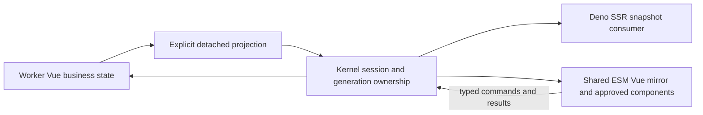

# Vue reactive backend and UI migration

Updated: 2026-11-12.

## Implemented

The SDK extension-point reactive core uses pinned Vue 3.5.13 headless production ESM. Native
ref/shallowRef/computed/watch/effectScope APIs replace the former signals API. Materialized plugin
imports reserve the runtime. Contributions preserve identity/order, service actor identity,
withdrawal, synchronous transition delivery and bounded owned streams. See the preceding SDK 0.2
implementation in repository history.

SDK 0.3 and [ADR 0050](architecture/decisions/0050-retire-custom-component-families.md) complete the
removal of the old component engine and authoring framework:

- The shared browser ESM uses one Vue runtime for assistant islands and built-in forms.
- Declarative forms use a separate versioned plain-data MIME/comm target, with local Vue drafts,
  shared model mirrors, submit/cancel actions and deterministic unmount/disposal.
- Kernel elicitation, declarative plugin forms, approved worker forms and REPL form producers
  use that form contract. Worker API creation and state publication are awaited.
- The old component registry, dependency collector/paint loop, injected bundled-source factory API,
  widget runtime/factories and widget JSX/TSX authoring dialect are deleted.
- Dependencies, lockfile, REPL bootstrap, extension contribution manifest, committed browser assets,
  tests and documentation move together. The obsolete engine comparison script is removed.
- Saved forms are permanently readonly data; legacy component source is discarded, with no
  component execution or model startup on restore.

This removes the old abstractions rather than reimplementing their APIs with Vue underneath.
Current form behavior and migration examples live in the
[UI design](custom-ui-framework-design.md).

## Remaining architecture

The current declarative form channel is not a general Vue business-model protocol. Further work
must keep the executable authoritative for conversation state while allowing an approved plugin
worker to own business data.

Each isolate has its own reactive graph. Proxies, refs, closures and computed functions never cross
IPC. Explicit projections contain bounded plain values; functions and actors are excluded, and
binary remains binary/resource references. Ready undefined, missing fields, deletion and pending
must be distinct protocol states.

Use a serialized publication pump per model and complete revisioned snapshots first. Several ref
changes within one action publish a coherent post-action projection. Observers only invalidate
owned work; they do not launch detached transport operations. Attach the initial revision and its
successors atomically. Add patches only with explicit base revisions and snapshot recovery.

Keep separate model, view, session, worker-generation and request identities. Unmounting one view
must not destroy shared state. Creation/attachment must work without borrowing whichever session
is foreground or requiring a live Agent run stream. Reconnection must recover state without
replaying side-effecting commands. Worker death, approval revocation and session close reject stale
generations and settle pending requests/subscriptions with typed causes.

Actions need correlated results, validation, typed errors and cancellation. A transport receipt is
not the business result. The existing form event channel carries submit/cancel events, not generic
RPC; its invoke result is not currently propagated to browser callers.

SSR consumes an explicitly captured projection and a matching approved component generation. It
must not own the worker's model, start producers or invoke actions. Hydration starts from that same
projection revision, then applies buffered newer state. Ordinary state changes update the browser
mirror without recompilation or rerunning component setup.

## Next implementation stages

1. Owned Vue business models, bounded projection codec and revisioned snapshot attachment, with
   explicit session/worker-generation admission and joined shutdown.
2. Typed action request/result/error/cancel routing, independent of render/rendered envelopes.
3. Approved reusable Vue component catalog in the shared ESM and matching SSR dependency resolution.
   Do not restore a custom family registry, paint engine or injected component-source dialect.
4. Integrate VitePress embedding, resource delivery and richer reusable controls through normal Vue
   components after the model/catalog contracts are verified.

Acceptance includes nested mutations/deletion, array edits, ready undefined, coherent actions,
concurrent requests, revision gaps, several views, independent model/view close, worker restart,
approval revocation, pending shutdown and SSR/hydration revision equality. Use real kernel/Deno and
browser coverage in addition to source-level tests; run NativeAOT validation for integration changes.
