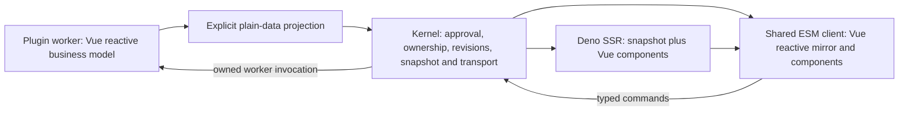

# Vue reactive backend and UI migration study

Date: 2026-11-11

Status: researched target architecture. The requested direction is to retire the Preact-based
abstractions and use Vue for both backend reactivity and browser components. Production migration
has not started in this change. The executable remains the conversation authority; plugin workers
may own business models without moving Agent orchestration into JavaScript.

Related: [streaming output design](streaming-output-rendering-design.md),
[previous UI design](custom-ui-framework-design.md), ADR 0037/0038/0040/0047, and
[`maieutics-output-client`](../deno/maieutics-output-client/README.md).

## Findings in the current implementation

There are three independent surfaces to replace, not just a browser component library.

| Surface                           | Current implementation                                                                                                        | Migration consequence                                                                                                                           |
| --------------------------------- | ----------------------------------------------------------------------------------------------------------------------------- | ----------------------------------------------------------------------------------------------------------------------------------------------- |
| Backend reactive extension points | SDK `reactive.ts` imports `signal`, `computed`, `effect` from `@preact/signals-core`; `ReactiveValue<T>` exposes `Signal<T>`  | Affects provide/unprovide, collections, subscriptions, remote contributions and service/HTTP-root identity, even without UI                     |
| Producer UI models                | SDK `ui/runtime.ts`, `plugin-ui.ts` and `widgets/runtime.ts` maintain plain maps with manual set/sync/update handlers         | They do not currently share an automatic backend dependency graph; replacing the browser renderer alone does not make these models Vue-reactive |
| Browser UI families               | VS Code `renderer/registry.ts`, `script.ts`, `bundled.ts`, form/widget TSX families use Preact and explicit collectDeps/paint | Replace with normal Vue components and a reactive model mirror in the shared ESM client                                                         |

The SDK exports the Preact primitives through `entry.ts`, `mod.ts` and `./reactive`; these are
plugin author APIs, not private implementation details. `PluginHostModule.cs` also reserves and
materializes the signals-core import mapping. REPL bootstrap separately installs the widget/native
UI runtimes. Those bindings, SDK exports, generated imports, lint rules and authoring examples all
need migration.

The existing widget JSX runtime is a custom model-tree authoring dialect. Its jsx/jsxs factories
create widget models, rather than normal browser components. The native bundled-family contract
similarly expects source calling an injected Preact registerViewFamily/h/Fragment API. Both are
retirement targets. Keeping these names while silently switching their meaning would obscure a
breaking change. Existing wire and snapshot decoders can be retained as adapters without retaining
Preact or its authoring/runtime abstraction.

## Target architecture



Use `@vue/reactivity` for long-lived worker state and dependency tracking, aligned with the existing
Vue 3.5.13 compiler/runtime. Workers need no DOM or component renderer to use ref/reactive/computed,
watch and effectScope. Use the bundled Vue runtime in the browser for both components and their
state mirror. The C# kernel owns approval, routing, session identity, bounded snapshots and frame
ordering; it does not need a Vue dependency or a JavaScript reactive graph.

Each process/isolate has an independent reactive graph. Sharing Vue terminology does not share Proxy
objects, dependency subscriptions, closures or computed functions across IPC. Existing actor
references remain actor references. UI state travels as explicit data projections; privileged
operations remain owned worker actions with existing capability/policy enforcement.

There must be one reactive runtime per realm wherever refs are used together. The browser ESM must
provide Vue APIs to plugin component factories/composables; a plugin must not bundle a second copy
of reactivity next to the bundled renderer. Pin import mappings in materialized worker roots and
reject conflicting plugin overrides. A separate worker may use its own pinned instance because it
does not share live JavaScript objects with the browser or another worker.

## Backend primitives and extension-point compatibility

Expose native Vue names such as ref/shallowRef/reactive/computed/effectScope. Remove the Preact
Signal contract from the final SDK. A temporary comparison adapter exists only in the research
script; it is not a proposal to retain signal/effect aliases indefinitely.

| Existing assumption                              | Vue behavior verified at 3.5.13                                    | Required treatment                                                                                                                  |
| ------------------------------------------------ | ------------------------------------------------------------------ | ----------------------------------------------------------------------------------------------------------------------------------- |
| signal(object) retains the original object       | ref(object) normally creates a reactive Proxy                      | Use shallowRef for contribution/service cells; use reactive/ref intentionally for mutable business data                             |
| effect(fn) returns a stop function               | Vue effect(fn) returns a callable runner; stop(runner) releases it | Rewrite subscriptions using owned watch handles/scopes; calling the old variable would rerun the effect and leak observation        |
| Contribution changes are observed synchronously  | Raw @vue/reactivity watch is synchronous unless given a scheduler  | Preserve extension collection transition semantics explicitly; do not apply the browser's default watch scheduling indiscriminately |
| A collection is readable but not caller-writable | Vue computed is a readonly computed ref                            | Accept readonly Ref-like sources and return readonly computed collections; do not require a mutable Signal type                     |
| Deep watch supplies a previous snapshot          | Nested mutations can supply the same object as old/new             | Capture detached published projections; never diff the two deep-watch callback arguments as historical states                       |

The pinned core package exports watch and effectScope but does not export the runtime-core
watchEffect helper. Its watch scheduling API also differs from the higher-level runtime watch
options. Internal backend observers should use the pinned raw API with an explicit scheduling
policy; do not document runtime-only helpers or copy newer-version examples without verification.

Preserve extension-point identity (owner module plus name), data versus service meaning,
registration order, provider withdrawal and admission behavior. The existing rule that undefined
means a provider is temporarily absent remains specific to the contribution API. It must not become
the UI data protocol's pending marker: ready undefined and pending UI data are different states.

For UI state, coalesce repeated invalidations into one detached projection at an owned publication
boundary. An action changing several refs should publish a coherent post-action state; background
changes may use a scheduled publication job. Coalescing is valid for replaceable state snapshots,
not commands, RPC results or extension-point streams whose contract preserves each change. Vue
reactivity provides dependency tracking, not a supported public transaction API or network queue.

## Reactive models and publication

A model factory receives a model/session lifetime and creates its state inside an effect scope. Its
proposed author surface separates private worker state, published fields and callable actions:

```ts
// Proposed API sketch, not an available SDK export.
const model = defineUiModel((ctx) => {
  const count = ref(0);
  const doubled = computed(() => count.value * 2);

  ctx.expose(() => ({ count: count.value, doubled: doubled.value }));
  ctx.action("increment", () => {
    count.value++;
  });
});
```

The exposed projection is a field whitelist, not an automatic walk of all worker state. Evaluate the
projection inside a tracked observer, including reads of nested published data. Encode it into a
detached bounded value before queueing it. An observer that reads only a shallowRef.value cannot
detect in-place mutations inside its unproxied value; that is intentional for service identities,
but mutable UI data needs a reactive graph or explicit shallow-value replacement.

Initial support should use bounded plain records/arrays/scalars. Define explicit presence encoding
for ready undefined, deletion and absence. Reject unsupported values/cycles with typed model errors.
Functions, actors and Vue objects are not UI state. Dates, maps, sets and big integers require a
documented value codec before being accepted. Binary data remains in native buffers/streams or
resource references, never JSON/base64. JSON in the feasibility probe merely demonstrates detached
plain values and dependency tracking; it is not the proposed production codec.

Keep a single serialized publication pump per model owner. Watch callbacks mark dirty work and
schedule it; they do not start unobserved async transport sends. Bound queues, retained state and
subscribers. Bootstrap subscriptions atomically from a captured revision plus its successors so
changes cannot disappear between initial snapshot creation and live attachment.

Start with complete bounded snapshots at a model revision. Add optional set/remove patches only with
a baseRevision, declared array semantics and snapshot recovery on mismatch. Preserve the browser's
root reactive object across accepted updates, apply deletion explicitly, and commit the revision
after the whole update. A single shallowRef replacement is an alternative with a clear granularity
cost. Keep a detached prior wire value if producing diffs.

## Communication, SSR and ownership

Use separate identities for the business model, mounted view and individual request. The kernel
binds them to a session, output, approved component and worker generation; the component cannot
choose an arbitrary plugin/worker. Model lifetime can outlive a run and support several frontends;
view disposal removes that view's subscriptions/requests without implicitly destroying shared data.
The current plugin UI announcement's live-run-stream requirement must be removed from this model
creation/attachment path. No event should be routed by whichever session happens to be foreground.

Browser mirrors are readonly projections. Component-local drafts, hover/expanded state and other
presentation state use ordinary local Vue refs. A v-model binding to backend data uses an action
adapter plus optional local draft/optimistic revision; it does not send arbitrary object mutations
back to the worker. Commands have request ids, schema validation, typed result/error/cancel frames
and worker generation checks. A transport acknowledgement is not an operation's business result.
Disconnects do not automatically replay side-effecting commands.

Reuse the existing session comm transport/owner-routing seam where suitable, but define the model
interaction protocol independently of render/rendered envelopes and the old Preact-family payloads.
The current UiEvent invocation result is ignored by PluginUiOwner; an RPC API requires explicit
result propagation. Binary comm capability does not automatically extend the current JSON-only
plugin UI capability payload; document/adapt that boundary before claiming end-to-end binary
support.

SSR consumes a captured model projection and matching component-generation dependencies. It does not
own the long-lived worker model, initiate producers, establish its live subscription or run worker
actions. Vue SSR's disabled reactive effects do not prevent a separate long-lived worker from using
@vue/reactivity. Hydration starts from the exact SSR projection revision, then applies buffered
newer revisions. Ordinary data changes update the browser mirror and Vue DOM directly; they do not
require recompilation or repeating server/component setup for every change.

Create synchronous model observers inside effectScope and close scopes at model/worker generation
retirement. Stopping a scope does not revoke retained refs or prevent lazy computed reads; retired
model admission/publication needs its own closed-generation guard. Async work needs separate
AbortControllers, observed completion tasks and joined pumps: scope.stop() is synchronous and is not
an async shutdown barrier. Effects created after await do not automatically belong to the earlier
scope.run call. Model setup should be synchronous; create later observers through explicit owner
reentry, and refuse creation after retirement. Do not hold an ambient scope open across arbitrary
asynchronous code.

Unsubscribe/iterator return must stop observation, settle an outstanding next exactly once and
release queued work. The existing reactive.ts adapters contain manual pending resolvers and queues;
their cleanup/backpressure needs explicit coverage rather than assuming the engine replacement fixes
it. Worker restart, plugin revocation and session closure fail pending operations with a typed cause
and reject stale generations. Revocation overrides a pinned presentation generation.

## Browser and legacy migration

Extend the shared ESM output client with the reactive model mirror and approved Vue component
catalog. Register dependencies into each output app before rendering/hydration. Keep component
types/keys and model bindings stable through compatible streaming template updates, so the parent
setup, child refs and subscriptions survive. Replacing a registry generation is an explicit
replacement boundary; unknown modules keep a stable fallback and do not block unrelated Markdown.

Port the built-in form to a Vue SFC, including field editing/focus, submit/cancel, stale snapshot
display and validation. Retain the C# elicitation producer as a typed data/action producer; it does
not need to construct Vue state. Replace widget rendering with Vue components if classic widget
compatibility is retained. Translate ipywidgets identities, nested model references, layout/style
state and events at that compatibility boundary, not through a permanent second renderer engine.

Remove the Preact family registry, collectDeps/paint loop, injected h/Fragment bundled contract, JSX
import-source settings and custom widget model-tree authoring dialect from the final path. Vue's
dependency tracking replaces manual view invalidation. Keep static native/legacy snapshot decoders
only as needed for old files; opening one never grants script execution or starts a business model.
No permanent Preact implementation or misleading compatibility alias is required.

Version the new SDK/component/model contract deliberately. Existing plugins using signal/effect or
bundled Preact families need migration diagnostics and examples, not silent reinterpretation under
the materialized SDK links override. New model announcements/capabilities are additive and
versioned; old frontends receive readable/static fallback. Canonical transcript source remains
provider-neutral; any model/component dependency stamps belong to versioned presentation metadata.
Approval still covers security-relevant declarations under ADR 0037; content hashes identify
artifacts/generations without silently changing the source-edit approval rule.

## Implementation sequence and acceptance

1. Migrate the SDK reactive core and host import mappings to pinned Vue, updating author APIs and
   examples. Preserve extension identity/service/HTTP behavior; prove real cross-worker contribution
   updates, admission, withdrawal, disposal and backpressure before replacing UI.
2. Add owned Vue business-model scopes, explicit projections and the kernel model interaction
   protocol, including session binding, request results, cancellation and snapshot attachment.
3. Add the shared ESM reactive mirror/component catalog; convert the built-in form through a real C#
   producer and a real plugin worker, then validate VitePress embedding and standalone use.
4. Port or retire the classic-widget compatibility surface and migrate plugin authoring. Remove
   Preact, signals-core and old registration/JSX machinery once no shipped source depends on them.

The stages isolate behavioral changes but converge on one Vue implementation. Acceptance must
include coherent multi-ref actions, nested mutations/deletion/array edits, ready undefined,
concurrent commands, revision gaps/reconnect, several views of one model, view versus model close,
worker death/revocation, pending iterator/request shutdown, deterministic SSR/hydration and
streaming instance preservation. Wire fixtures and public documentation change when contracts ship.
NativeAOT publish plus actual browser/kernel/plugin verification is required for integration
changes.

## Evidence and reproduction

Tested with Deno 2.9.6 and Vue reactivity 3.5.13. The study does not update production dependencies,
embedded bundles, public SDK or wire formats.

- Nine explicit probes pass: service identity, effect runner semantics, synchronous withdrawal,
  nested projection tracking, deep-watch aliasing, controlled scheduling, scope cleanup, retained
  computed reads after stop and async owner reentry.
- Existing reactive.ts local tests pass unchanged against Preact (12/12) and against a temporary Vue
  shallowRef/computed/watch comparison adapter (12/12). The script copies sources and the lock to a
  temporary directory; the adapter exists only there. These legacy tests include timing waits, so
  this is compatibility evidence, not the deterministic acceptance suite for the migration.
- Real cross-worker/HTTP/worker-restart behavior, browser rendering, new model protocol and final
  package-size/performance effects are not validated by those local experiments.

From the repository root, use a populated pinned-runtime cache:

```sh
cp deno/deno.lock /tmp/maieutics-vue-study.lock
deno test --no-config --import-map=deno/research/vue-reactivity-migration/imports.json \
  --lock=/tmp/maieutics-vue-study.lock --frozen=false --cached-only --allow-env=NODE_ENV \
  deno/research/vue-reactivity-migration/probe.ts
python3 deno/research/vue-reactivity-migration/compare_existing.py --deno /path/to/deno-2.9.6
```

The temporary lock preserves the repository's transitive pins while permitting the study's direct
@vue/reactivity specifier. Source tests need NODE_ENV for the npm entry. No production file is
rewritten and no cache miss is fetched by these commands.

Upstream evidence:
[pinned reactivity exports](https://github.com/vuejs/core/blob/v3.5.13/packages/reactivity/src/index.ts),
[pinned watch implementation](https://github.com/vuejs/core/blob/v3.5.13/packages/reactivity/src/watch.ts),
[reactivity package usage note](https://github.com/vuejs/core/blob/v3.5.13/packages/reactivity/README.md),
[effect scopes](https://vuejs.org/api/reactivity-advanced.html#effectscope),
[Vue SSR reactivity](https://vuejs.org/guide/scaling-up/ssr#reactivity-on-the-server).
